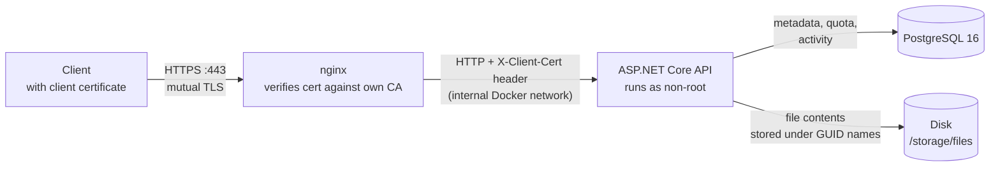

# Raspi Storage

**A self-hosted alternative to cloud storage that runs on a Raspberry Pi 5.**

Raspi Storage is a custom file storage service hosted on a Raspberry Pi 5. Its purpose is to store files securely and give access to them from any device.

There are no passwords and no login. A client can access files only with a valid certificate signed by the server's certificate authority. Any other client is refused during the TLS handshake, before a single byte reaches the application.

I built it to keep my own files at home instead of with a cloud provider. The aim was a small backend that stays **correct under failure**: quota, database and disk must never drift apart, even if a request dies halfway through.

---

## Table of contents

- [Features](#features)
- [Architecture](#architecture)
- [Design decisions](#design-decisions)
- [Tests](#tests)
- [Tech stack](#tech-stack)
- [Project structure](#project-structure)
- [Getting started](#getting-started)
- [API](#api)

---

## Features

- 📁 **Files**: upload (up to 1 GB), download, rename, move, delete
- 🗂️ **Nested folders**: create, rename, move, and delete a whole subtree in one call
- 📊 **Per-user quota**: every upload and delete updates the user's used bytes atomically
- 🔐 **Certificate-based auth**: the user is identified by the certificate's Common Name, with no passwords and no tokens
- 📝 **Activity log**: a per-user history of uploads, downloads, renames, moves and deletes
- 🛡️ **Input validation and clean errors**: consistent `400 / 401 / 404 / 409` responses, and a generic `500` that never leaks internals

---

## Architecture



1. **nginx** terminates TLS. It requires a client certificate (`ssl_verify_client on`) and checks it against the private CA. If the certificate is missing or invalid, the connection is rejected right there.
2. nginx forwards the verified certificate to the API in the `X-Client-Cert` header. ASP.NET Core's certificate forwarding turns the header back into an `X509Certificate2`.
3. A middleware reads the certificate's **Common Name** and looks up the user with that username. An unknown CN gets `401`.
4. **PostgreSQL** holds the metadata: users, quotas, the folder tree, file records and the activity log.
5. **File contents** are written to disk under random GUID names. The human-readable name and the folder structure exist only in the database.

**Network exposure:** port `443` is the only port open to the network. The API container has no published port and is reachable only through nginx. Postgres is published on `127.0.0.1` only, for local maintenance from the Pi itself.

---

## Design decisions

These are the parts I spent the most time on. Each one fixes a concrete way the system could break.

**Database and disk stay consistent.**
An upload writes the file to disk first. It then inserts the record, updates the quota and writes the activity entry in **one transaction**. If any step fails, the transaction rolls back and the file is deleted from disk, so no orphaned files are left behind. Deletes run in the reverse order: the database transaction commits first, then the file is removed from disk. A record whose file is already missing can still be deleted.

**Quota cannot be exceeded, even by concurrent uploads.**
The used-bytes counter is not changed with a read-modify-write. It is changed with a single guarded `UPDATE` whose `WHERE` clause only matches while `used_bytes + delta <= quota_bytes`. If no row is updated, the quota is full and the whole upload rolls back. On top of that, `CHECK (used_bytes >= 0)` and `CHECK (used_bytes <= quota_bytes)` constraints make an invalid state impossible at the database level.

**Folder moves cannot create cycles.**
Before a folder is moved, the service walks up the ancestors of the target folder. If it meets the folder being moved, the request is rejected with `409`. Without this check, moving a folder into its own subfolder would cut the subtree off from the root and make the recursive delete loop forever.

**Deleting a folder deletes the whole tree safely.**
Inside one transaction, the service collects every file in the subtree. It then subtracts their total size from the quota, deletes the folder (`ON DELETE CASCADE` removes everything below it) and records the action. Files are removed from disk only **after** the commit. A failure there is logged and does not undo a successful delete.

**The activity log survives deletion.**
Activity rows keep the target's id and name but have **no foreign key** to files or folders. A "deleted folder X" entry stays readable after X is gone. Uploads and deletes are logged in the same transaction as the action itself.

**Duplicate names are prevented by the database.**
Unique indexes on `(owner, parent folder, name)` enforce unique names per folder. Because of `COALESCE` on the parent id, this also works at the root level, where the parent is `NULL`. The resulting Postgres error `23505` is turned into a readable `409 Conflict`.

**Names are validated in one place.**
One rule set is reused by a custom `[ValidName]` attribute on the request DTOs and by the upload path, which has no DTO. A name must not be empty, must be at most 255 characters and must not have leading or trailing whitespace. `.`, `..`, `/`, `\` and control characters are not allowed.

**Errors are predictable and nothing leaks.**
A global exception middleware maps domain exceptions and specific Postgres errors to `400 / 404 / 409`. Any other exception is logged with its full stack trace and returned as a generic `500`. It also handles two edge cases: a client that aborts the request (logged as info, no response) and a response that has already started.

**Large uploads go straight through the proxy.**
nginx allows bodies up to 1 GB and has request buffering turned off (`proxy_request_buffering off`). An upload is passed straight to the API instead of being written to nginx's disk first.

**Least privilege.**
The API container runs as an unprivileged user (`1000:1000`). nginx gets only the CA **certificate**. The CA **private key** never touches the server, so a compromised server cannot issue new client certificates.

---

## Tests

The suite has **62 integration tests**, and nothing is mocked:

- The whole application runs in memory through `WebApplicationFactory`, with the real middleware pipeline, controllers, services and SQL.
- **Testcontainers** starts a disposable PostgreSQL 16 container and applies the same `Database/schema.sql` that production uses.
- Client certificates are generated in code and sent in the `X-Client-Cert` header, exactly as nginx sends them.

Covered areas: requests without a certificate, upload/download round-trips, quota limits and quota refunds on delete, duplicate names, name validation, folder-cycle protection, recursive folder deletion (subfolders, files on disk, quota, activity entry), and deleting a record whose file is already missing on disk.

To run them (Docker must be running, because the tests start a real PostgreSQL container):

```bash
dotnet test tests
```

---

## Tech stack

| Layer | Technology |
|---|---|
| API | .NET 10, ASP.NET Core (controllers + custom middleware) |
| Data access | Dapper over Npgsql with hand-written SQL |
| Database | PostgreSQL 16 |
| Reverse proxy / TLS | nginx with mutual TLS |
| Deployment | Docker Compose on Raspberry Pi 5 (ARM64) |
| Logging | Serilog (console + daily rolling file) |
| Testing | xUnit, `WebApplicationFactory`, Testcontainers (real PostgreSQL) |

---

## Project structure

```
├── Controllers/     HTTP endpoints for files, folders, activity
├── Services/        Business logic: transactions, quota, cycle checks, tree delete
├── Data/            Dapper repositories and connection factory
├── Middleware/      Certificate → user resolution, global exception handling
├── DTOs/            Request/response contracts and the [ValidName] attribute
├── Models/          Database entities and options
├── Exceptions/      Domain exceptions mapped to HTTP status codes
├── Database/        schema.sql: tables, constraints, indexes, seed user
├── nginx/           nginx.conf with mutual TLS and proxy settings
├── tests/           xUnit integration tests (Testcontainers)
├── Dockerfile       Multi-stage build (SDK → ASP.NET runtime)
└── docker-compose.yml
```

---

## Getting started

### Prerequisites

- Docker and Docker Compose
- `openssl` (to create the certificates)
- .NET 10 SDK (only to run the tests)

### 1. Environment variables

Create a `.env` file in the project root (it is git-ignored):

```env
POSTGRES_DB=raspistorage
POSTGRES_USER=raspistorage
POSTGRES_PASSWORD=change-me
```

Postgres uses these values to create the database. Docker Compose also builds the API connection string from them, so this file is the only configuration you need.

### 2. Certificates

All of these are created **outside** the repository. Set the two variables at the top first. Every command below uses them.

```bash
SERVER_SAN="DNS:<server-hostname>,IP:<server-lan-ip>"
CLIENT_USER="<username>"

# Certificate authority (keep ca.key offline; never copy it to the server)
openssl req -x509 -newkey rsa:4096 -nodes -days 3650 \
  -keyout ca.key -out ca.crt -subj "/CN=Raspi Storage CA"

# Server certificate (SAN must cover every address clients use)
openssl req -newkey rsa:2048 -nodes -keyout server.key -out server.csr -subj "/CN=raspi-storage"
openssl x509 -req -in server.csr -CA ca.crt -CAkey ca.key -CAcreateserial -days 825 -out server.crt \
  -extfile <(printf "subjectAltName=$SERVER_SAN")

# Client certificate (CN must equal the username in the database)
openssl req -newkey rsa:2048 -nodes -keyout client.key -out client.csr -subj "/CN=$CLIENT_USER"
openssl x509 -req -in client.csr -CA ca.crt -CAkey ca.key -CAcreateserial -days 825 -out client.crt

# Optional: bundle for browsers / OS keychains
openssl pkcs12 -export -inkey client.key -in client.crt -certfile ca.crt -out client.p12
```

- **`SERVER_SAN`** lists every address clients use to reach the server. Use the `DNS:` prefix for names and `IP:` for addresses. The client checks the address it connects to against this list, so a missing entry fails with a certificate error.
- **`CLIENT_USER`** becomes the certificate's Common Name and must equal a `username` in the `users` table.

**Access from outside your network (port forwarding).** Forward an external port on your router to port `443` of the server, and add the public address to `SERVER_SAN`. A dynamic DNS name is better than a public IP, because home IPs change:

```bash
SERVER_SAN="DNS:<server-hostname>,IP:<server-lan-ip>,DNS:<your-ddns-domain>"
```

If you change the addresses later, issue a new server certificate with the same CA. Client certificates stay valid. Opening the port is reasonably safe here: nginx drops every connection without a client certificate signed by your CA, during the TLS handshake.

Copy only these three files into `./server/` (git-ignored):

```
server/
├── ca.crt
├── server.crt
└── server.key
```

### 3. Storage and log directories

The API runs as uid/gid `1000`. It needs write access to the storage directory and the log directory:

```bash
sudo mkdir -p /storage/files
sudo chown -R 1000:1000 /storage/files
mkdir -p logs && sudo chown 1000:1000 logs
```

> If a bind-mounted directory does not exist, Docker creates it **owned by root**. Uploads then fail with `500` (access denied). If your user's uid is not 1000 (check with `id`), change `user:` in `docker-compose.yml`.

### 4. Users

The last line of `Database/schema.sql` seeds one user, `test-user`, with a 10 GB quota. Before the first start, change `test-user` to the CN of your client certificate. **A user is a row in `users` plus a client certificate whose CN matches its `username`.**

### 5. Run

```bash
docker compose up -d --build
```

The API is now available at `https://<server-address>/api/...` to clients that present a valid certificate.

Logs go to the console (`docker compose logs -f api`) and to `./logs/app.log`, with a new file every day. Every request is logged with its method, path, status and duration. Unhandled exceptions are logged with their full stack trace.

> `schema.sql` runs **only when the database volume is first created**. After changing the schema, recreate the volume with `docker compose down -v`. ⚠️ This erases all stored metadata.

---

## API

All endpoints require a valid client certificate. All IDs are GUIDs. Omitting `folderId` or `parentId` means the root level.

### Files: `/api/files`

| Method | Route | Description |
|---|---|---|
| `GET` | `/api/files?folderId={id}` | List files in a folder (root if omitted) |
| `GET` | `/api/files/{id}` | Get file metadata |
| `POST` | `/api/files?folderId={id}` | Upload (`multipart/form-data`, field `file`) |
| `GET` | `/api/files/download/{id}` | Download file contents |
| `PATCH` | `/api/files/rename/{id}` | Rename, body `{ "name": "new.txt" }` |
| `PATCH` | `/api/files/move/{id}` | Move, body `{ "folderId": "…" }` (or `null` for root) |
| `DELETE` | `/api/files/{id}` | Delete file and free its quota |

### Folders: `/api/folders`

| Method | Route | Description |
|---|---|---|
| `GET` | `/api/folders?parentId={id}` | List subfolders (root if omitted) |
| `GET` | `/api/folders/{id}` | Get folder metadata |
| `POST` | `/api/folders` | Create, body `{ "name": "Photos", "parentId": null }` |
| `PATCH` | `/api/folders/rename/{id}` | Rename, body `{ "name": "…" }` |
| `PATCH` | `/api/folders/move/{id}` | Move, body `{ "folderId": "…" }` (or `null` for root) |
| `DELETE` | `/api/folders/{id}` | Delete folder with all subfolders and files |

### Activity: `/api/activity`

| Method | Route | Description |
|---|---|---|
| `GET` | `/api/activity?limit={n}` | Most recent actions of the current user |

### Examples

```bash
# Upload a file to the root
curl --cert client.crt --key client.key --cacert ca.crt \
  -F "file=@holiday.jpg" \
  https://<server-address>/api/files

# Create a folder
curl --cert client.crt --key client.key --cacert ca.crt \
  -H "Content-Type: application/json" \
  -d '{"name": "Photos", "parentId": null}' \
  https://<server-address>/api/folders
```

### Error responses

| Status | When |
|---|---|
| `400` | Invalid name, value too long, quota exceeded, missing file |
| `401` | Certificate has no CN, or no user matches the CN |
| `404` | File or folder does not exist **or belongs to another user** |
| `409` | Name already taken in that folder, or folder moved into its own subtree |
| `500` | Unexpected error (details only in the server log) |

Requests without a valid certificate never reach the API. nginx rejects them during the TLS handshake.
